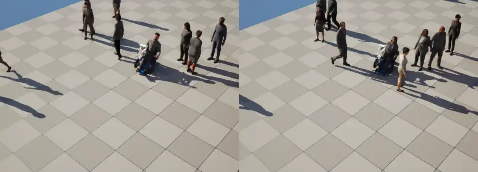
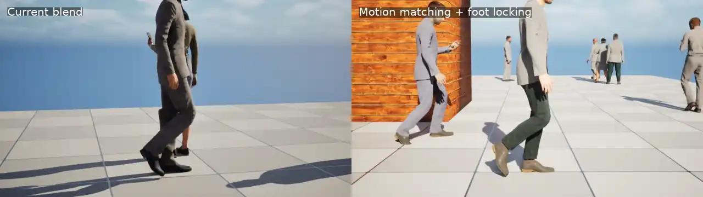
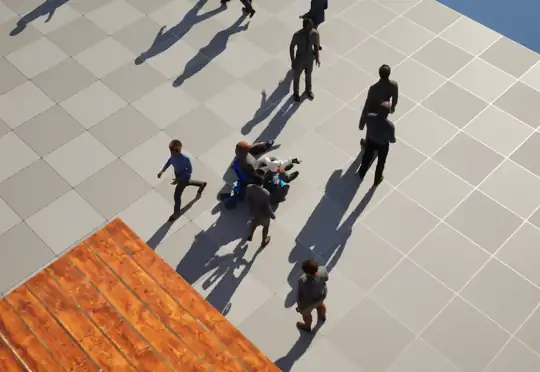
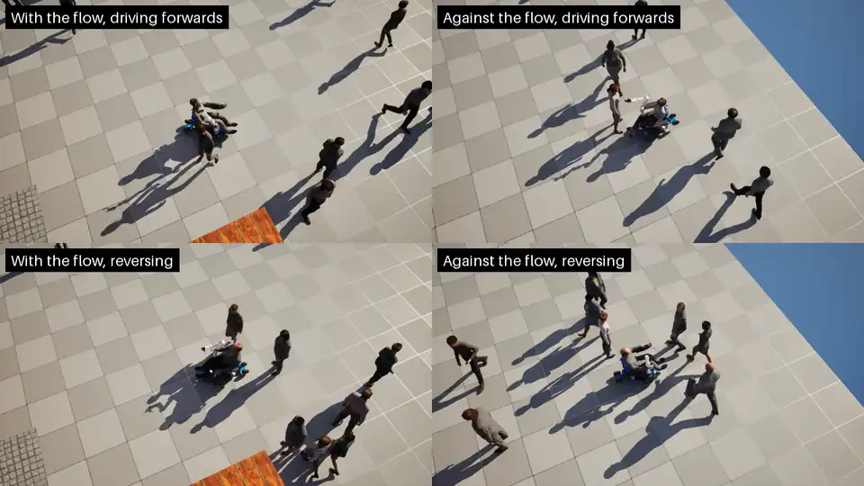
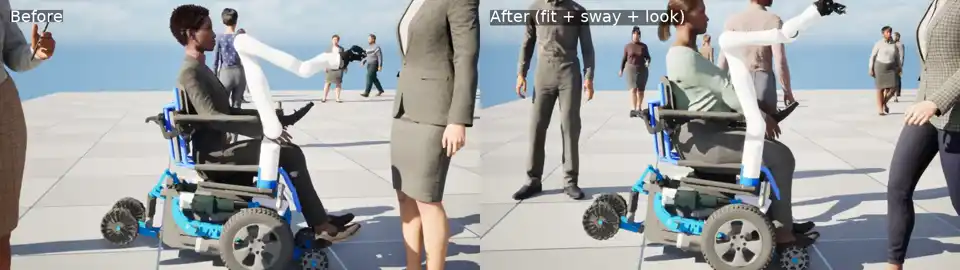

# RammsCrowd Customization Guide

How to change what the crowd looks like and how it behaves. Everything here is data
authoring — the design goal is that a new NPC kind (different look, different reactions)
requires zero plugin C++.

Prerequisite reading: [SETUP.md](SETUP.md) for what each asset is.

## Modifying the people (appearance)

### Appearance variety (City Sample characters)

`BP_CrowdPerson_CS` subclasses City Sample's `BP_CrowdCharacter`, which exposes a
parametric appearance system in the class defaults:

- **`RandomOptions` = true** (the reference setup): every spawned actor re-rolls
  gender, body weight, head (6), skin (6), hair style/color, outfit, fabric, pattern,
  accessory, and height scale in its construction script. Pooled actors keep their look
  while alive, so nearby pedestrians are visually stable for sensor work.
- **Pinned looks**: set `RandomOptions` = false and pick the indices (`Skeleton`,
  `Body Shape`, `HeadIndex`, `OutfitIndex`, ...) in a *subclass* of `BP_CrowdPerson_CS`.
  Useful for uniformed kinds (e.g. a worker crowd): one subclass per look, one entity
  config per subclass, mixed via spawner `CrowdProfiles` proportions.

### Swapping the people entirely (own meshes / MetaHumans)

Any skeletal mesh works. Recipe (this is exactly how the mannequin-based
`BP_CrowdPerson` fallback is built):

1. Plain `AActor` blueprint: capsule (blocks Visibility+Camera, QueryOnly) +
   `USkeletalMeshComponent` (your mesh, RT-visible, no collision) +
   `URammsCrowdAnimComponent`. **Not** `ACharacter` — CharacterMovement fights Mass
   transform writes.
2. Mesh facing: meshes authored facing +Y (UE mannequin, MetaHumans) need yaw −90 —
   on the mesh component if it's a child, or via the agent trait's
   `RepresentationActorYawOffsetDegrees` if the mesh is the actor root.
3. Point the entity config's Mass Crowd Visualization `HighResTemplateActor` at it.
4. Animation: give the anim component a `URammsCrowdAnimSet` built for the mesh's
   skeleton (preferred, see "Crowd animation" below), or a locomotion blend space, or
   just `IdleAnim`/`WalkAnim` sequences + `WalkAnimReferenceSpeedCmS` for
   hard-switching playback.

MetaHumans: use the optimized/runtime export preset (hair cards — strands are also
unreliable for ray-traced sensor views), retarget idle/walk onto the MetaHuman skeleton
once with the IK Retargeter, then follow the recipe. Budget 2–4 distinct MetaHumans and
keep the `LODMaxCount` cap in mind.

### Crowd animation (`URammsCrowdAnimSet` + `URammsCrowdAnimInstance`)

When the anim component's `AnimSet` is set (the shipped `BP_CrowdPerson_CS` points at
`/Game/NPCs/DA_CrowdAnimSet`), the component installs `URammsCrowdAnimInstance` on
the actor's leader mesh at begin play. It is a graph-less anim instance (no
Animation Blueprint asset) that builds each pedestrian's pose from Mass data:

- **Variety.** Per body type (City Sample gender and build) the set lists forward walk
  variants, a brisk walk, idles and carry styles. Each pedestrian gets one walk, one
  idle and, with `CarryChance`, something to carry: phone (looking at it, talking,
  holding), cup, backpack, briefcase or purse. The hold pose is layered over just
  the holding arm (and the head, for looking down at a phone), and the prop is put on
  the matching hand bone or the backpack socket in the actor's `Accessory`
  component. Picks are seeded by the Mass entity, so a pooled actor recycled onto
  another entity becomes someone else.
- **No foot sliding.** The forward walk, brisk walk and the shared directional walks
  (diagonals, sidesteps, backwards) are blended by the angle between facing and
  travel and by speed. All of them share one gait phase through their L/R foot sync
  markers, so blended clips plant the same foot together, and they play at the rate
  that makes their root speed equal the agent's measured speed (clamped to
  `MinPlayRate`..`MaxPlayRate`). Below `IdleBlendEndCmS` the idle blends in.
- **Noticing the robot.** Inside the stimulus react radius every pedestrian turns its
  head (spread down the neck and upper spine, within `LookAtMaxYawDegrees` /
  `LookAtMaxPitchDegrees`) toward the robot's user; in the aware radius a share of
  them (`WatchRobotChance`) do. A Mass look-at target set by a StateTree takes
  precedence.
- **Reactions.** A startle (the robot coming at the pedestrian) or a
  bump (`URammsRobotClearanceProcessor` pushing the agent out of the footprint, counted
  in `FRammsRobotContactFragment`) plays an upper-body flinch from `Reactions`, with
  `ReactionCooldownSeconds` between them.

Build or refresh the set from the City Sample pack with
`Content/Python/ramms_crowd_build_anim_set.py` (it measures every walk's root speed and
direction, and assigns the set to `BP_CrowdPerson_CS`). Tuning lives on the asset, so
open `DA_CrowdAnimSet` to change carry chances, blend speeds or look-at limits; it
takes effect on the next PIE run. For another skeleton, fill a set with that
skeleton's clips: the bones it uses by name are `clavicle_l/r` (carry layers),
`neck_01` (phone head), `spine_01..05`, `neck_02`, `head` (reactions and look-at) and
the clips' "L" sync markers (gait phase; a clip without them counts as one cycle).

`URammsCrowdAnimInstance` exposes what each pedestrian picked (`BodyKey`, `WalkName`,
`IdleName`, `CarryName`) and its `LocomotionPlayRate`, `FootSpeedCmS` and
`ReactionCount` for debugging.

### Motion matching

Instead of blending the per-body walk and directional clips, the anim instance can
pick locomotion by motion matching (UE Pose Search) against the Game Animation
Sample's (GASP) relaxed walk: real starts, stops, turns in place and pivots
instead of a walk blended to the agent's speed. Carry poses, reactions and look-at
layer on top unchanged.

- **Content**: `Content/Python/ramms_crowd_build_motion_matching.py` builds it
  from a GASP project created from Fab. It copies the GASP pieces it needs,
  retargets the 57 clips the relaxed walk databases use onto the City Sample body,
  and copies those databases onto the crowd skeleton, keeping their tuning
  (`URammsCrowdMotionMatchingLibrary::AdaptPoseSearchDatabases`). It then fills
  the anim set's `MotionMatching` sets.
- **Retargeting legs by FK.** The retarget uses a copy of GASP's
  `RTG_UEFN_to_Metahuman_nrw` with its IK ops turned off, so the leg joint
  rotations are copied as captured. The IK version kept the feet exactly on their
  source paths but re-bent the knees for the longer MetaHuman legs: straight at
  heel strike, crouched in stance (median knee 35° against the capture's 29°) and
  stiff in the swing (65° peak against 75°). With FK the feet drift a centimetre
  or so per step, which foot locking absorbs.
- **Orientation warping** (`MaxOrientationWarpDegrees`). Mass turns the body
  after its velocity, so a clip walking straight ahead can be heading somewhere
  the body isn't going. The hips and legs turn toward the direction of travel and
  the spine turns most of the way back, so the steps go where the body goes
  instead of the planted feet sliding sideways.
- **Database sets** (`FRammsCrowdMotionDatabases`): `Stand`, `TurnInPlace`,
  `Start`, `Move` and `Stop`. Like GASP's chooser, only the set that fits the
  moment is searched, so costs from different schemas never compete. The set
  is chosen from the current speed and the predicted speed 1 s ahead.
- **Prediction**: the path eases from the current velocity onto the lane Mass
  is following (`TrajectoryResponseSeconds`), at its desired speed. It slows to
  a stop when the pedestrian will stand at its goal, and the pedestrian turns to
  face the direction it walks.
- **Playback**: searches run every `MotionMatchingSearchInterval` and when the
  set changes or a one-shot clip runs out. New clips cross-fade over
  `MotionMatchingBlendSeconds`. Playback is scaled toward the agent's speed
  within `MotionMatchingMinPlayRate`..`MotionMatchingMaxPlayRate`.
- **Status**: on wherever the sets are filled; `bUseMotionMatching` switches it
  off without clearing them. In RAMMS-Sim the generated content is committed
  (`Content/CrowdMM/AnimsFK` and `DatabasesFK`, about 84 MB; they depend only on
  the City Sample crowd from Fab) and `DA_CrowdAnimSet` has it on. Pose Search
  builds the database indexes into the derived data cache on first load, which
  takes a little while once per machine. Debug values on the instance: `bMotionMatching`,
  `MotionPhase`, `MotionMatchedClip` and `MotionMatchSwitches`. Next steps: a
  mirror table for the crowd skeleton and limiting it to nearby agents.

### Feet: stride warping and foot locking

Mass moves the pedestrians, not the clips' root motion. Whenever the body's speed
or direction differs from the clip's, a planted foot would slide. This shows most in
motion-matched starts, stops and turns, and in standing pedestrians nudged by
avoidance. Three things keep the feet honest, on both locomotion paths:

- **Stride warping** (`bStrideWarping`, `MinStrideScale`..`MaxStrideScale`). The
  difference between the agent's speed and the clip's is split: mostly playback
  rate, the rest by lengthening or shortening the steps along the direction of
  travel. Re-placing the feet changes how the knees bend (shorter steps bend the
  leg reaching forward, longer ones straighten the trailing leg), so it is kept
  small. The
  clip speed is the blend of all playing clips, and the scales are eased (0.2 s),
  so a newly matched clip never changes the legs in one frame.
- **Foot lift scaling** (`bScaleFootLift`, `MinFootLiftScale`). Clips captured at
  a brisk walk (GASP's is 165 cm/s) lift the toe and raise the heel far more than
  a slower walker would. Below the clip's speed, the foot's height above the
  ground and its heel-rise / toe-lift rotation are scaled toward a flat foot by the
  speed ratio. Toe lift at heel strike is scaled on the ground too, but heel rise
  and height only once the foot is in the air: lowering the heel of a planted foot
  would force the trailing leg straight. A swinging foot is never lowered beyond
  the leg's reach as the clip has it.
- **Foot locking with heel-to-toe roll** (`bLockPlantedFeet`).
  - **Contact:** comes from the clips' `contact_l` / `contact_r` curves when they
    have them (GASP clips do: heel strike to toe-off). Otherwise it comes from foot
    heights; an ankle check keeps a toe dipping mid-swing from counting as a plant.
  - **Roll:** at heel strike the heel (a fixed point of the foot, the sole under
    the ankle in the bind pose) is pinned where it lands and the foot rolls
    about it. Once the ball is down the pin moves to the ball, which is also the
    pivot at toe-off. The leg reaches the pinned foot with two-bone IK, and the knee
    bends the way it does in the clip.
  - **Release:** at toe-off the foot eases back to the clip over the swing
    (`FootReleaseSeconds`), so the next step lands where the clip puts it.
  - **Walking:** while walking, a planted foot holds against drift up to
    `WalkingFootLockMaxCm` (11 cm) along the path and 1.6 times that sideways
    (the path curving under a planted foot is easy for the legs to take), then
    gives way by that much. A walking foot never takes a procedural step. Start
    and stop clips plant their feet deliberately, so during them the feet hold
    firmly (stepping if the body gets too far away).
  - **Flat feet count as planted** even when the contact curve says otherwise:
    the curves can start a little after the foot lands and end a little before it
    lifts, and a flat foot that isn't held slides. Holding on longer
    stretched the leg straight and ended the stance with a procedural step in
    place of the clip's swing, which looked robotic.
- **Corrective steps.** If the body drifts more than `FootLockMaxDistanceCm` from
  a pinned foot, the foot takes a procedural step (`FootStepSeconds`,
  `FootStepHeightCm`) back under the body instead of stretching or sliding. Only
  one foot steps at a time unless the leg is badly overstretched. These are for
  standing and slow pedestrians; walking feet slip instead (above).
- **Hips and knees.** Each leg is solved once, after every foot change, with a
  two-bone IK that keeps the clip's knee direction (remembered while the leg is
  nearly straight, where it would otherwise be noise). A pose the clip plays as
  captured is left exactly as captured, straight knees included. If a foot ends up
  beyond the leg's reach the hips dip (up to 5 cm, as a walker's do into a long
  step) and the knee eases off full extension (soft IK) rather than snapping.
  While walking the hips don't dip: near full extension a centimetre of hip
  height is ten degrees of knee on the other leg. If
  shorter steps bring the planted feet closer, the hips rise (up to 3.5 cm) so the
  knees keep the clip's bend instead of crouching.

Motion matching adds two stop-specific pieces:

- **Distance-matched stops.** A stop clip is played so that the distance its root
  still travels equals the distance the agent has left to where it will stand
  (`MassDistanceToStop`, measured from the agent rather than Mass's steering target,
  which runs ahead of it).
- **Play-out.** Once a start or stop clip is chosen it plays out rather than being
  re-searched mid-transition. Re-searching would hop between left- and right-foot
  variants and tangle the feet. What follows is matched early enough that the
  cross-fade finishes before the clip runs out: a clip that has ended freezes,
  and a frozen planted foot slides along with the body. Within the walk loop,
  a match to another moment of the same loop is ignored (it would only cross-fade
  between two step phases).

The motion-matching pose history records the clip's own feet, before warping and
locking, because that is what the search compares against.

Debug values on the instance: `StrideScale`, `FootLiftScale`, `LockedFeet`, `FootLockCorrectionCm`,
`FootLockOverstretches` (the number of steps taken), `FootContactFromCurves`,
`PelvisDropCm` (negative when raised), `FootLockBits` (per foot: locked, stepping,
pinned at the ball) and `FootDebug` (left knee angle in the clip and after
adjustment, and the clip's hip-to-ankle distance over the leg's reach).

### Fallback animation (`URammsCrowdAnimComponent` without an anim set)

Without an `AnimSet` the component drives the mesh itself as a single node:

| Property | Effect |
|---|---|
| `LocomotionBlendSpace` | Direction × Speed blend space, fed live. The shipped `BS_CrowdLocomotion` covers ±180° at walk speed plus idle and quick-walk rows |
| `IdleAnim` / `WalkAnim` / `WalkAnimReferenceSpeedCmS` | fallback pair when no blend space; ref speed = ground speed the walk was authored at (measure it — see scripted authoring) |
| `GaitVariation` (via agent trait) | per-agent play-rate jitter and phase desync (±half the value) |
| `ForceLOD0/1/2DistanceCm` | distance clamp for the City Sample LODSync (arm bones vanish at mesh LOD 2+); raise to trade fidelity for GPU headroom. Applies with or without an anim set |
| `DirectionAngleDegrees`, `MassSpeed`, `bMassIsMoving`, `LookAtDirection` (world space), `StimulusZone`, `StimulusLocation`, `LastStartleTime`, `RobotContactCount` | BlueprintReadOnly outputs for your own anim instance or AnimBP; the single-node driver yields to any mesh with an anim class set |

The blend space itself is a normal asset — open `BS_CrowdLocomotion` to retune axis
smoothing or swap sample clips. If you *script* blend-space edits, call
`unreal.RammsCrowdAnimAssetLibrary.rebuild_blend_space(bs)` afterward: without the
resample, the asset evaluates to reference pose ("A-pose") with frozen time. Note the
runtime triangulation of script-authored blend spaces does not survive editor restarts
at all — `URammsCrowdAnimComponent` therefore self-heals its blend space once per
editor session before first playback (editor-only; cooked builds bake blend spaces
during packaging).

## Modifying the behaviors

### Tuning reactions (no editor restart, no recompile)

All proxemics live in `DA_Reaction_*` assets (`URammsCrowdReactionProfile`): zone radii,
exit hysteresis, the approach-speed startle threshold, whether only a moving robot
startles (`bStartleOnlyWhenStimulusMoves`), startle cooldown, back-away distance and
speed scales. How agents pass the robot (planning lookahead, comfort gap, keep-right,
slowdown) lives on the RAMMS Player Avatar trait in `DA_MassConfig_PlayerAvatar`.

 Edit between PIE runs; verify with
`ramms.crowd.DebugStimulus 1`.

Walking speed/mix: Mass Movement trait (speed + variance), and the Stand duration in
the StateTree controls the walk/pause rhythm.

### Changing behavior structure (StateTree)

`ST_Pedestrian` is a normal StateTree asset — open it in the editor. The shipped C++
vocabulary to compose from:

| Node | Kind | Does |
|---|---|---|
| `RAMMS Stimulus` (`FRammsStimulusEvaluator`) | evaluator | exposes Zone/Distance/ClosingSpeed/StimulusEntity/AwayDirection for binding |
| `RAMMS Stimulus Zone` (`FRammsStimulusZoneCondition`) | condition | zone ≥ MinZone (invertible) |
| `RAMMS Closing Speed` (`FRammsClosingSpeedCondition`) | condition | approach speed ≥ threshold |
| `RAMMS Back Away` (`FRammsBackAwayTask`) | task | retreat along AwayDirection while facing the stimulus, lane-safe distances |
| `RAMMS Stand At Path End` (`FRammsStandAtPathEndTask`) | task | marks a ZoneGraph path target (bind the wander target, between it and Path Follow) as ending in a stand. The engine's wander target ends paths with a Move intent, so Mass applies no arrival slowdown: agents hit the goal at full speed, overshoot and creep back. `ST_Pedestrian`'s Wander state uses it because Stand always follows |
| engine: ZG Find Wander Target / Path Follow / Stand, LookAt, Find Escape Target, NavMesh tasks | tasks | locomotion + gaze building blocks |

Recipes:
- **Yield (robot-like kinds)**: state gated on `Zone ≥ React` with `ZG Stand`
  (duration 0) + `Mass LookAt` (target bound to the evaluator's StimulusEntity);
  transition out when the condition clears (zone-change signals re-tick the tree).
- **Flee (pets/animals)**: state gated on `Zone ≥ Startle` with
  `ZG Find Escape Target` → `ZG Path Follow`; pair with the stimulus source's
  `bTriggerLaneDisturbance` so fast robot motion marks lanes as dangerous.
- **Rules**: reaction states must *interrupt* path-follow as siblings (never parallel —
  single writer for the move target). Interrupt transitions on Wander/Stand should be
  OnTick + a zone condition; the perception processor's signals wake the tree, so
  steady state costs nothing.

### Adding a new NPC kind (data only)

1. Duplicate `DA_Reaction_Person` → tune proxemics.
2. Duplicate `ST_Pedestrian` → recompose reaction states from the vocabulary above.
3. Duplicate the entity config → swap reaction profile, StateTree, meshes
   (representation template actor), movement style, `ActorKind`.
4. Create a `URammsCrowdAgentProfile` pointing at the config; add it to the spawner's
   `CrowdProfiles` with a proportion (e.g. Person 0.8, Robot 0.2).

### Extending the vocabulary (C++)

- New tasks/conditions: subclass `FMassStateTreeTaskBase` / `FMassStateTreeConditionBase`
  in *your* module (mirror `RammsBackAwayTask` — note `Link()`, `GetDependencies()`, and
  the fixed StateTree wake-signal list: custom signals must be accompanied by
  `UE::Mass::Signals::NewStateTreeTaskRequired`).
- New per-kind parameters without plugin edits: define a `FMassConstSharedFragment`
  struct, add an instance to the reaction profile's `ExtensionParams` — the reaction
  trait bakes it as a const-shared fragment your custom nodes can require.
- New stimulus sources: add `URammsStimulusSourceComponent` to any actor (vans, other
  robots), or push snapshots into `URammsStimulusSubsystem` directly for virtual
  stimuli.

## Seated people (`URammsSeatComponent`)

Puts a posed skeletal-mesh occupant into any seat — the wheelchair, benches,
vehicle seats. Add the component to the actor, position it at the seat surface
(component transform = seat origin, X forward / Z up), done: on BeginPlay it
spawns the occupant, attaches it, disables its collision/physics, and applies a
parametric seated pose.

- **Occupants**: City Sample crowd characters by default (optionally
  appearance-randomized per spawn; soft-referenced, so a missing pack logs a
  warning and leaves the seat empty instead of failing), or any skeletal mesh
  via `ExplicitMesh` mode.
- **The pose is data**: `PoseBoneOffsets` is a bone-name → rotation map applied
  over the reference pose (`URammsSeatedPoseAnimInstance` — no anim graph, no
  authored sit animation needed, skeleton-agnostic since missing bones skip).
  Tune it live in the details panel; changes re-apply immediately, including in
  PIE. Different seats can carry different poses.
- **Axis semantics** (UE-standard skeletons — City Sample, mannequin; bones have
  X along the bone): **Yaw = flexion/bend** (hip, knee, elbow, spine fwd/back),
  **Pitch = lateral swing** (arm abduction, spine side-lean), **Roll = twist
  about the bone's own long axis**. A pure Roll moves no child joint — it looks
  exactly like "the pose isn't applying", so if a limb won't bend, check that
  the offset isn't in Roll. Signs are identical on both body sides (mirrored
  bone frames).
- **Editor preview**: `Spawn Occupant` / `Clear Occupant` / `Apply Pose` buttons
  on the component work without PIE (preview occupants are transient — never
  saved into the map).

### Fitting the occupant to the seat (`Ramms|Seat|Fit`)

The pose map gives the overall posture; the fit layer then puts the body *on*
the chair, whatever the occupant's build. All locations are in seat space
(the component's frame, cm).

- **`bAlignPelvis` / `PelvisLocation`**: moves the whole pose so the pelvis bone
  lands on this point (sits the occupant on the cushion, back against the
  backrest). Legs and arms are re-placed afterwards, so they don't drift.
- **`LeftHand`, `RightHand`, `LeftFoot`, `RightFoot`** (`FRammsSeatLimbTarget`):
  two-bone IK per limb. `Location` is where the wrist/ankle goes, `PoleLocation`
  which way the elbow/knee points, `Weight` blends from the pose (0) to the
  target (1). `RelativeToBone` makes the target follow another bone — e.g. a hand
  resting in the lap uses `thigh_r` (the hip joint). `EndRotation = KeepPose` keeps the hand/foot
  orientation from the pose (feet flat on a footplate) instead of following the
  forearm/shin.
- **`BodyAdjustments`**: per-build corrections keyed by a substring of the
  occupant mesh name (`_ovw`, `_unw`, …). `Pelvis` shifts the pelvis target;
  `OnBody` shifts targets that use `RelativeToBone` (a thin thigh is lower than
  a heavy one). City Sample builds share one joint layout but differ in flesh,
  so this is what keeps a hand on the lap rather than in it.

`BP_Mebot_Ramms` in RAMMS-Sim carries a worked fit for the MeBot: left hand on
the joystick module, right hand resting in the lap (the robot arm owns the
right armrest), feet on the front of the base (there are no footplates). The
right hand's relaxed finger curl is ordinary `PoseBoneOffsets` entries, taken
from a frame of a City Sample idle (offset = reference⁻¹ × idle, per finger
bone) rather than set by hand.

### Occupant motion (`Ramms|Seat|Motion`)

The occupant is a wheelchair user, so **the legs never move on their own**: no
weight shifts or foot adjustments. Everything here acts on the spine, neck and
head, after the fit and before the hand IK, so hands stay where the fit put
them. Every part has its own switch and strength:

| Property | Effect |
|---|---|
| `bPassiveSway`, `SwayAmount` (0–3) | Physics, not intent: the trunk lags the chair — leans back when it speeds up, forward when it brakes, outward in turns — as a damped spring on the seat's measured acceleration. |
| `TrunkControl` (0–1) | How well the occupant holds their trunk. Low = slower, bouncier and larger sway; high = stiff and quickly damped. Also how much the head counter-rotates to stay level. |
| `bVoluntaryMotion`, `VoluntaryAmount` (0–2) | Master switch and strength for the voluntary layer below (0 = a still, upright occupant). |
| `bLookWhereGoing` | Looks into turns, and over the shoulder when reversing (on the side the back of the chair is swinging toward). |
| `bLookAtPeople` | Now and then glances at a pedestrian within ~3.5 m in front or beside the chair. |
| (always, scaled by `VoluntaryAmount`) | Breathing, slow trunk drift, idle glances around every few seconds. |
| `SetLookAtLocation(World)` / `ClearLookAt()` | Scripted gaze target; overrides all of the above until cleared. |

The anim instance exposes the current `SwayPitchDegrees`, `SwayRollDegrees`,
`LookYawDegrees` and `LookPitchDegrees` for debugging and tests.

## Scripted authoring (Python / Remote Control)

Everything above can be driven headlessly — the plugin's editor module ships utilities
for the pieces the stock Python API can't reach:

| Call | Purpose |
|---|---|
| `unreal.RammsCrowdStateTreeLibrary.create_pedestrian_wander_state_tree(path, name)` | build + compile the baseline pedestrian StateTree |
| `Content/Python/ramms_crowd_build_anim_set.py` | build `DA_CrowdAnimSet` from the City Sample pack (measured walk speeds/directions, carry styles, reactions) and assign it to `BP_CrowdPerson_CS` |
| `unreal.RammsCrowdAnimAssetLibrary.rebuild_blend_space(bs)` | validate/resample a blend space after scripted edits (mandatory) |
| `unreal.RammsCrowdZoneGraphLibrary.update_zone_shape(comp)` | recompute a `UZoneShapeComponent` after setting its points from script |
| `unreal.RammsCrowdZoneGraphLibrary.rebuild_zone_graph()` | trigger the Build ZoneGraph action |

The `Map_CrowdTest` zone network, entity configs, blend space, and character blueprints
in RAMMS-Sim were authored entirely through this path (Remote Control HTTP →
`ExecutePythonCommandEx`), so the project history doubles as a worked example. Useful
measurement trick: `unreal.AnimPoseExtensions` can extract root-motion speed from a walk
clip to get an exact `WalkAnimReferenceSpeedCmS`.
